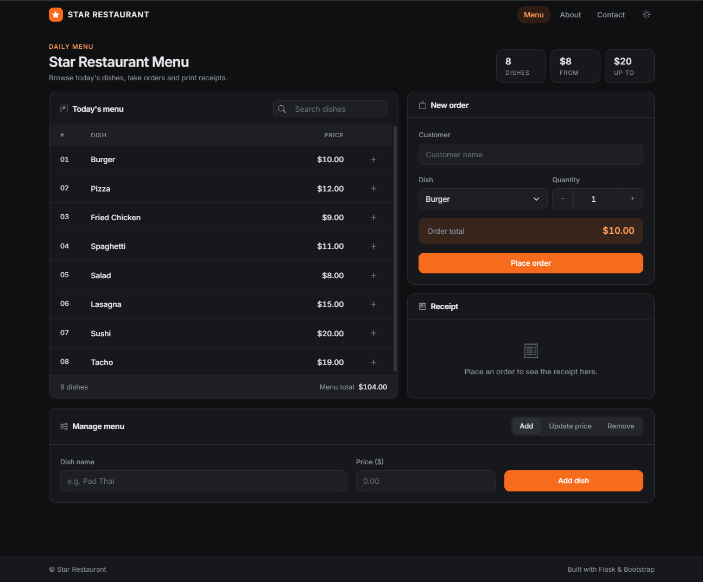
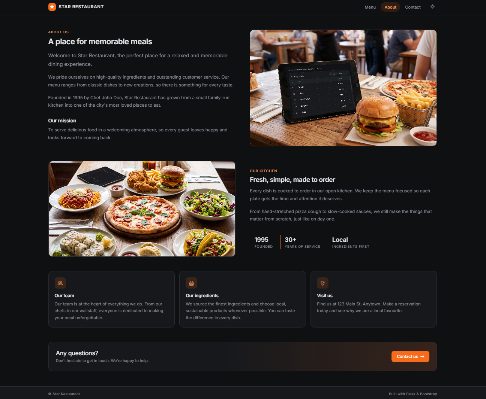
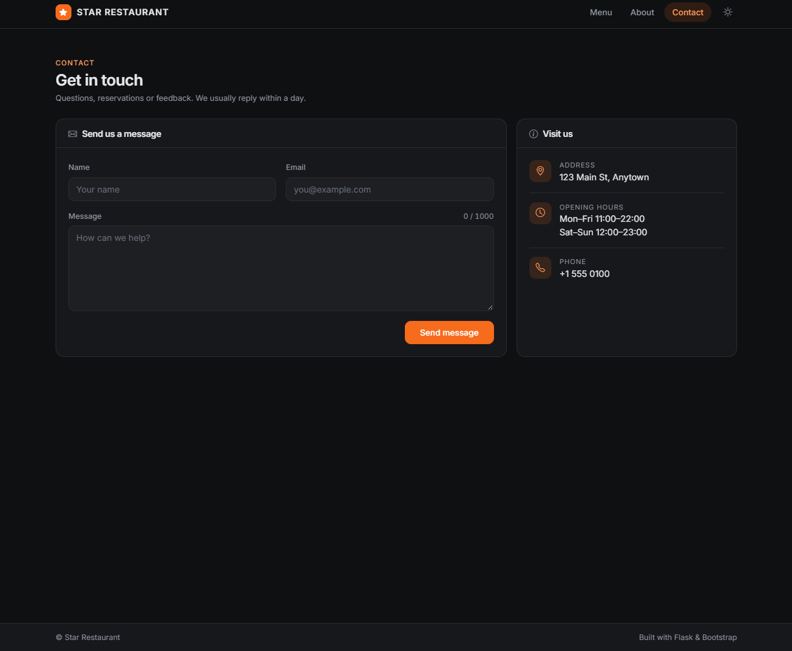
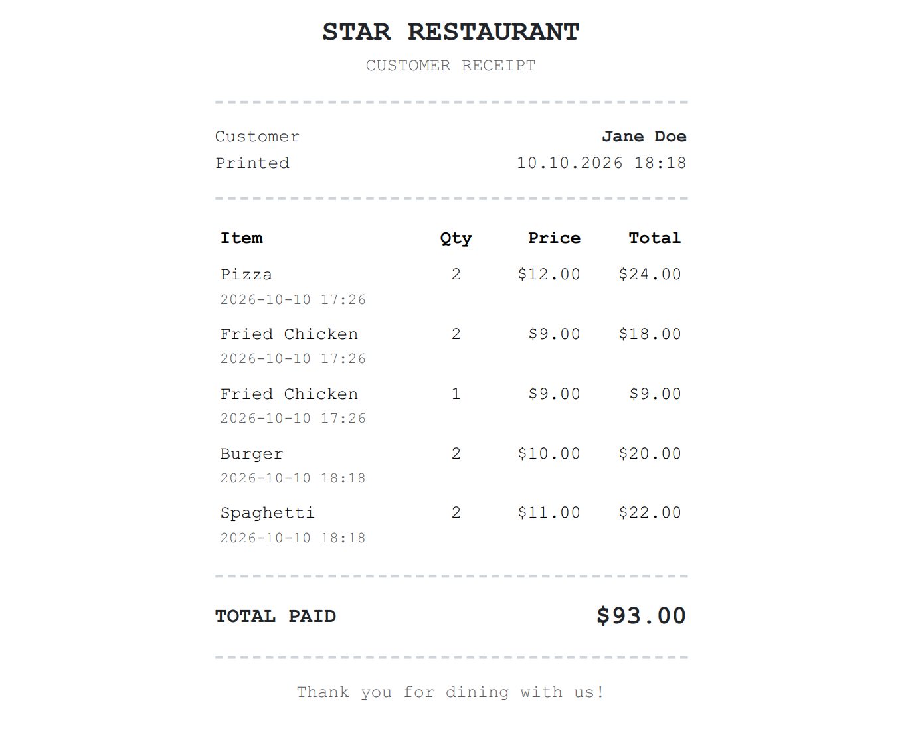

# ⭐ Star Restaurant

A small full-stack restaurant app built with **Flask**, **JavaScript** and **Bootstrap**.

The goal of this project is to show the basics of CRUD operations in a classic Flask application. It is meant as a learning project for students, not a production-ready system.

## Features

- **Menu management:** add, update the price of and remove dishes
- **Orders:** place an order for a customer with a live total
- **Receipts:** view each customer's order history and print it as a receipt
- **Contact form:** messages are saved to a JSON file
- Live menu search and toast notifications

## Tech stack

| Layer    | Technology                                   |
| -------- | -------------------------------------------- |
| Backend  | Python, Flask, Jinja2                        |
| Frontend | HTML, Bootstrap 5, vanilla JavaScript        |
| Storage  | In-memory menu, JSON files for orders        |
| Server   | Flask dev server locally, Gunicorn in Docker |

## Project structure

```text
.
├── app.py                # Flask routes and app setup
├── data.py               # Restaurant and Food classes
├── requirements.txt
├── Dockerfile
├── static/
│   └── css/style.css     # Global theme
└── templates/
    ├── base.html         # Layout, navbar, footer
    ├── index.html        # Menu, orders and menu management
    ├── receipt.html      # Printable receipt
    ├── about.html
    └── contactus.html
```

## Run locally

Requires Python 3.10 or newer.

```bash
# Create and activate a virtual environment
python -m venv venv
source venv/bin/activate        # Windows: venv\Scripts\activate

# Install dependencies
pip install -r requirements.txt

# Start the app
python app.py
```

Open <http://localhost:3000> in your browser.

## Run with Docker

```bash
docker build -t star-restaurant .
docker run -d -p 3000:3000 \
  -v star-data:/data \
  -e SECRET_KEY=a_long_random_string \
  --name star-restaurant \
  star-restaurant
```

Open <http://localhost:3000> in your browser.

The `star-data` volume keeps orders and contact messages when the container is removed or rebuilt.

## Environment variables

| Variable     | Default                            | Description                                                                       |
| ------------ | ---------------------------------- | --------------------------------------------------------------------------------- |
| `SECRET_KEY` | `dev-secret-key`                   | Used by Flask to sign session data. Set your own value outside local development. |
| `DATA_DIR`   | Project folder (`/data` in Docker) | Where `orders.json` and `customers_messages.json` are stored.                     |

## ScreenShots

### Home



### About



### Contact



### Receipt



## Good to know

- The menu is kept in memory, so changes to the menu reset when the app restarts. Orders and contact messages are saved to JSON files.
- The app runs with a single Gunicorn worker on purpose: multiple workers would each have their own copy of the in-memory menu.
- There is no authentication. Anyone who can open the app can edit the menu.

These limits keep the code simple and easy to follow. Good next steps for practice: move the menu and orders into a database (e.g. SQLite with SQLAlchemy), add login for staff, and write tests with `pytest`.
